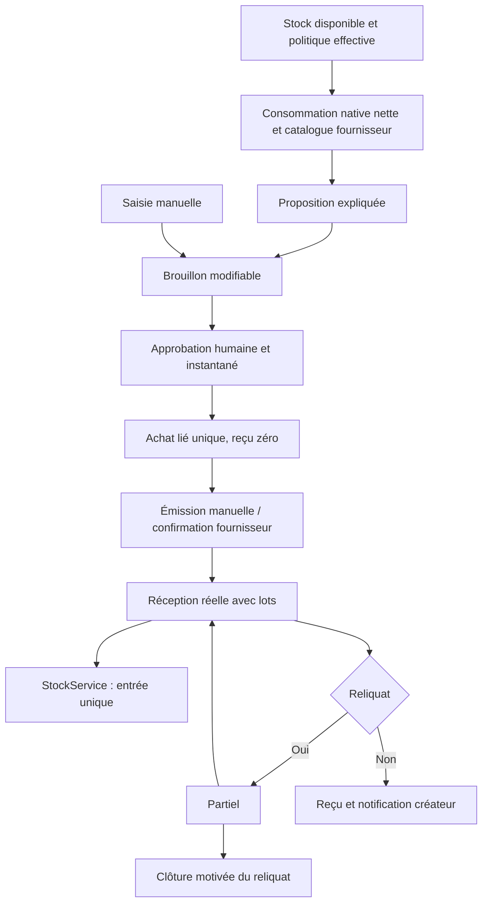

# Flux et invariants du réapprovisionnement

| Action | Stock | Trace |
|---|---|---|
| Créer produit | Aucun | Règles catalogue existantes |
| Calculer suggestion / créer brouillon | Aucun | Run et raisons figées |
| Approuver | Aucun | Événement et achat lié unique |
| Émettre / confirmer | Aucun | Acteur, motif, version |
| Recevoir | Entrée réelle | Réception, lot, mouvement et clé |
| Accepter surplus | Quantité reçue seulement | Avenant et autorisation |
| Clôturer reliquat | Aucun retrait du reçu | Révision financière motivée |

Transactions, verrous d'acteur/boutique/bon, versions et clés idempotentes protègent les mutations. Un conflit de contenu avec la même clé est refusé. Le calcul utilise des décimaux/rationnels exacts, pas des flottants financiers. FEFO/FIFO, péremptions et CMV restent ceux des services stock/vente existants.

Un fournisseur de catalogue n'est pas la provenance d'un lot. Les rapports fournisseur suivent réception → achat fournisseur et les allocations physiques de vente/retour. Une ligne répartie entre fournisseurs est ventilée selon ces allocations, avec arrondis cumulatifs pour conserver les totaux ; les quantités sans provenance ne sont pas réattribuées.

Le déploiement est additif après sauvegarde restaurée et vérifiée. Ni fresh, ni seed de démonstration, ni conversion BDT, ni modification des secrets. Les preuves privées et checkpoints sont sous `storage/app/replenishment` ; aucun push automatique.
